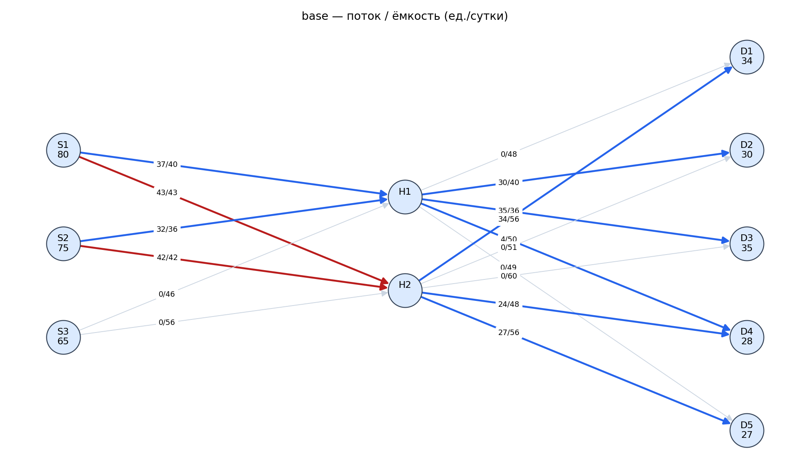
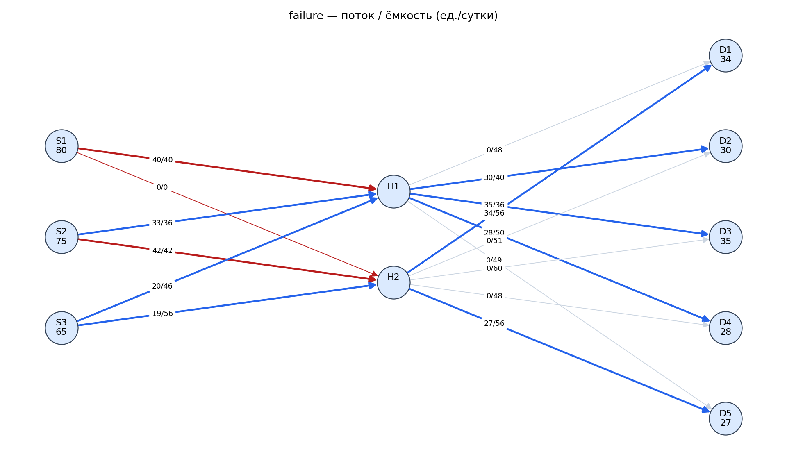
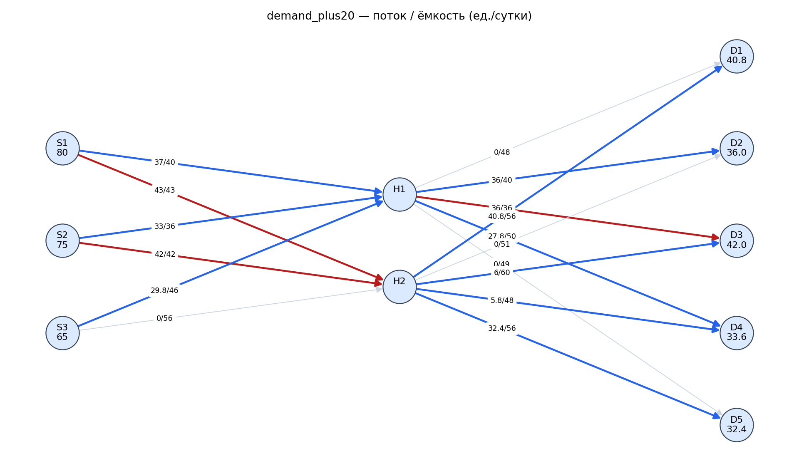
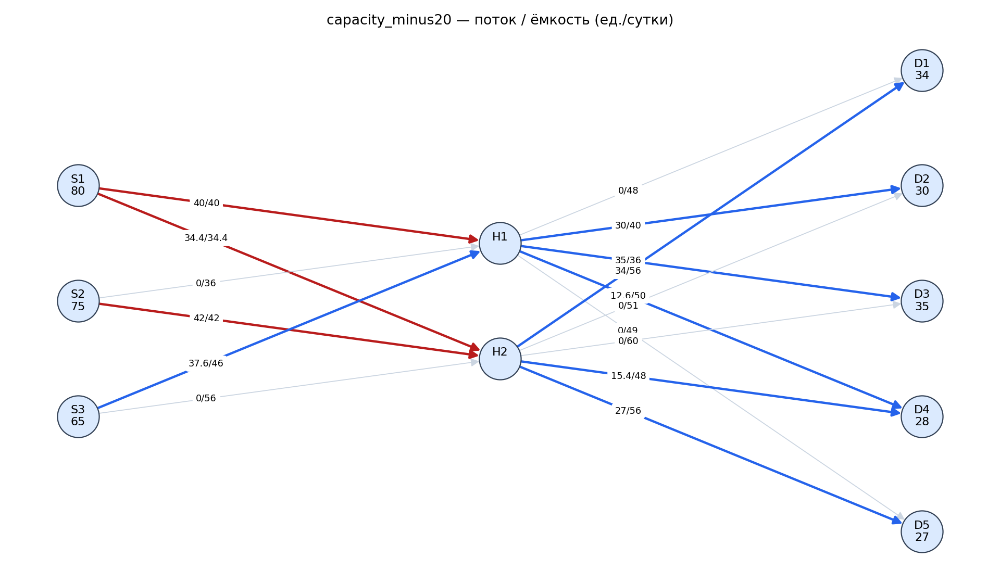

# НИЯУ МИФИ. Методы оптимизации
## Лабораторная работа № 2. Транспортные и сетевые модели

ФИО: [указать перед сдачей].

Группа Б24-507. Вариант 2. Порядковый номер 15.

### 1. Постановка задачи

Требуется доставить груз из трёх источников S1–S3 через два промежуточных склада H1–H2 пяти потребителям D1–D5 с минимальными затратами. V = 1 + ((17·15 + 7·0 + 26) mod 20) = 2; seed = 10015.

Источники располагают 80, 75 и 65 т/сутки соответственно (всего 220), спрос потребителей — 34, 30, 35, 28 и 27 т/сутки (всего 154). Сеть включает 10 вершин и 16 направленных дуг. Тарифы измеряются в условных денежных единицах (у.е.) за тонну, ёмкости — в т/сутки. В графиках «ед.» означает тонну. Данные синтетические: запасы заданы вручную, спрос, ёмкости и тарифы сгенерированы NumPy default_rng(10015) равномерным выбором целых чисел из диапазонов 25–35, 35–60, 2–12 соответственно. Полные данные в data.json.

### 2. Математическая модель

S — множество источников, H — хабов, D — потребителей. E = (S × H) ∪ (H × D). a_s — доступный запас, b_d — спрос, U_ij — ёмкость дуги, c_ij — тариф. x_ij — непрерывный поток по дуге в т/сутки.

Цель: min Z = Σ_(i,j)∈E c_ij x_ij (у.е./сутки).

Ограничения:
- Σ_h x_sh ≤ a_s для каждого s∈S (доступное предложение);
- Σ_s x_sh − Σ_d x_hd = 0 для каждого h∈H (баланс хаба);
- Σ_h x_hd = b_d для каждого d∈D (полное удовлетворение спроса);
- 0 ≤ x_ij ≤ U_ij для каждой дуги.

Модель содержит 16 переменных, 3 неравенства предложения, 7 равенств и границы переменных. Неиспользованный запас остаётся у источника. Склад не накапливает груз. Прямых поставок нет. Тарифы линейны, груз делим, время перевозки и фиксированные издержки не учитываются. Пропускная способность хаба определяется его дугами.

### 3. Реализация

Python 3.13.5, SciPy 1.17.0, HiGHS 1.8.0, NumPy 2.3.5, NetworkX 3.6.1, Matplotlib 3.10.8. Используется scipy.optimize.linprog(method='highs-ds'), двойственный симплекс-метод, presolve включён, допуск прямой и двойственной допустимости 10⁻⁷. Запасы извлекаются в порядке перечисления источников, независимо от порядка ключей JSON. Независимая проверка отклоняет векторы неверной размерности и значения NaN/Inf до расчёта балансов. Матрица инцидентности содержит +1 для исходящей и −1 для входящей дуги. В строках потребителей правая часть равна −b_d. Статус optimal означает найденный глобальный минимум; infeasible — требования несовместимы; unbounded — цель не ограничена (в данной модели конечные границы исключают это); time/iteration limit — оптимальность не подтверждена; numerical failure — численная ошибка. Фактически во всех четырёх сценариях получен optimal.

### 4. Базовое решение

| Дуга | Поток | Ёмкость | Тариф | Теневая цена ёмкости |
|---|---:|---:|---:|---:|
| S1 → H1 | 37 | 40 | 6 | 0 |
| S1 → H2 | 43 | 43 | 2 | -4 |
| S2 → H1 | 32 | 36 | 7 | 0 |
| S2 → H2 | 42 | 42 | 5 | -2 |
| S3 → H1 | 0 | 46 | 7 | 0 |
| S3 → H2 | 0 | 56 | 10 | 0 |
| H1 → D1 | 0 | 48 | 10 | 0 |
| H1 → D2 | 30 | 40 | 4 | 0 |
| H1 → D3 | 35 | 36 | 11 | 0 |
| H1 → D4 | 4 | 50 | 9 | 0 |
| H1 → D5 | 0 | 49 | 7 | 0 |
| H2 → D1 | 34 | 56 | 7 | 0 |
| H2 → D2 | 0 | 51 | 12 | 0 |
| H2 → D3 | 0 | 60 | 12 | 0 |
| H2 → D4 | 24 | 48 | 9 | 0 |
| H2 → D5 | 27 | 56 | 3 | 0 |

Источники отгружают 80, 74 и 0 т/сутки. Через H1 проходит 69 т, через H2 — 85 т. Все пять потребителей получают необходимый объём. Затраты: 37·6 + 43·2 + 32·7 + 42·5 + 30·4 + 35·11 + 4·9 + 34·7 + 24·9 + 27·3 = 1818 у.е./сутки. Нулевые потоки соответствуют маршрутам, не требующимся для выбранного оптимального плана; часть из них может использоваться в другом оптимальном плане при равных предельных затратах.

### 5. Независимая проверка

Функция check получает только исходные данные и числовой вектор потоков. Она накапливает входящий и исходящий поток для каждой вершины отдельно, проверяет ограничения и пересчитывает стоимость без использования объекта решателя или его матрицы. Допуск 10⁻⁷. Базовые балансы: S1=80≤80, S2=74≤75, S3=0≤65; H1: 69−69=0; H2: 85−85=0; потребители получают 34,30,35,28,27. Все 16 границ соблюдены. Пересчитанная стоимость совпадает с результатом HiGHS. Проверки остальных сценариев приведены в JSON-файлах results.

### 6. Сценарные эксперименты

| Сценарий | Спрос | Стоимость | Изменение | Статус | Итерации |
|---|---:|---:|---:|---|---:|
| Базовый |154|1818|0|optimal|4|
| Дефицит: ёмкость S1→H2 −20% |154|1858|+40|optimal|3|
| Стресс: отказ S1→H2 |154|2087|+269|optimal|6|
| Рост спроса +20% |184,8|2254,8|+436,8|optimal|5|

Наибольшая относительная загрузка равна 100% у S1→H2 и S2→H2. При равенстве выбрана первая дуга в порядке исходных данных (S1→H2); она также несёт больший абсолютный поток. При уменьшении её ёмкости с 43 до 34,4 поток H2 уменьшается с 85 до 76,4, недостающее количество перенаправляется через H1. Стоимость растёт на 2,20%. При полном отказе остаётся 0 т на этой дуге, часть груза поступает из S3 (39 т), затраты растут на 14,80%. При росте спроса до 184,8 т задействуется S3 (29,8 т) и насыщается H1→D3. Затраты растут на 24,03%, то есть быстрее спроса. Все сценарии остаются допустимыми; независимая проверка пройдена в каждом.

### 7. Узкие места и двойственные оценки

Насыщенные дуги S1→H2 и S2→H2 имеют оценки верхних границ −4 и −2 у.е. на дополнительную единицу ёмкости соответственно. При малом увеличении ёмкости первой дуги затраты уменьшаются на 4 у.е., второй — на 2 у.е. Приоритет расширения — S1→H2. Для уменьшения ёмкости на 8,6 т линейный прогноз составляет +34,4, фактический рост +40: базис изменился, локальная оценка перестала действовать на всём интервале. Для полного отказа прогноз +172 также меньше фактического +269. В базовом плане активна граница предложения S1, её оценка −1. Оценки балансов потребителей в node_prices.csv отрицательны из-за записи правых частей как −b_d; предельные стоимости увеличения спроса равны 14, 11, 18, 16, 10 соответственно. Совместный рост спроса даёт локальный прогноз прироста 430,8 (0,2·(34·14+30·11+35·18+28·16+27·10)); фактический прирост 436,8. Теневые цены применимы локально, не гарантируют точного прогноза при больших изменениях.

### 8. Жадная эвристика

Перечисляются все 30 маршрутов источник–хаб–потребитель и сортируются по сумме тарифов двух дуг. Для каждого маршрута отправляется минимум из остатка предложения, спроса и двух остаточных ёмкостей. Обратных перераспределений нет. Независимая проверка подтвердила допустимость жадного плана. Его стоимость равна 1818; зазор (1818−1818)/1818·100%=0%. На этих данных эвристика случайно достигает оптимума, но для произвольных данных такой гарантии нет: дешёвый маршрут может занять ёмкость, необходимую другому потребителю. Оптимальность здесь подтверждена решателем, а не эвристикой.

Для проверки устойчивости эвристики дополнительно повторим сравнение во всех сценариях.

| Сценарий | HiGHS, у.е./сутки | Жадный план, у.е./сутки | Допустимость жадного плана | Зазор, % |
|---|---:|---:|---|---:|
| Базовый | 1818 | 1818 | Да | 0 |
| Снижение ёмкости на 20% | 1858 | 1858 | Да | 0 |
| Отказ дуги | 2087 | 2087 | Да | 0 |
| Рост спроса на 20% | 2254,8 | 2272,8 | Да | 0,7983 |

Во всех сценариях жадный план удовлетворяет спросу полностью. При росте спроса он дороже оптимального на 18 у.е./сутки: последовательный выбор дешёвых путей не учитывает возможность перераспределить ранее назначенные потоки. Таким образом, совпадение с оптимумом в базовом сценарии не означает, что эвристика оптимальна всегда. Зазор рассчитывается только для допустимого жадного плана при наличии оптимального решения LP с ненулевой стоимостью. Результаты сохранены в `results/greedy_comparison.csv`, потоки и проверки — в `results/greedy_*_flows.csv` и `results/greedy_*_check.json` (для базового сценария — `greedy_flows.csv` и `greedy_check.json`).

### 9. Вывод

Найденный план удовлетворяет весь спрос и минимизирует затраты. Наиболее выгодное направление локального расширения — S1→H2. Даже при отказе этой дуги спрос выполняется благодаря резерву предложения и альтернативным маршрутам, но с увеличением затрат. Практическая реализация возможна при делимом грузе и стабильных тарифах; для неделимых рейсов, учёта сроков и запасов хабов необходима более подробная модель. Источники: методические указания к ЛР2; лекции 7, 8 и 10 по двойственности, транспортным задачам и потокам.

### 10. Дополнительное задание № 1. Неделимые рейсы: LP и MILP

Сохраняем исходные запасы, спрос, ёмкости и тарифы. Учебное допущение: один рейс перевозит ровно 1 т груза, а в хабе груз может перегружаться на другой транспорт. Поэтому число рейсов k_ij измеряется в рейсах/сутки, поток x_ij = 1·k_ij т/сутки. В модели из раздела 2 заменяем непрерывные переменные на k_ij ∈ Z, 0 ≤ k_ij ≤ U_ij. Цель min Σ c_ij k_ij, балансы и запасы остаются прежними. Фиксированные расходы на запуск машины не вводятся, чтобы сравнивать одну и ту же задачу и её LP-релаксацию.

Решение: scipy.optimize.milp (HiGHS, presolve=True, mip_rel_gap=0). LP-релаксация решается тем же двойственным симплекс-методом, что и основная задача.

| Модель | Статус | Стоимость, у.е./сутки |
|---|---|---:|
| LP | optimal | 1818 |
| MILP | optimal | 1818 |

Интегральный зазор: (1818 − 1818)/1818 · 100% = 0%. HiGHS обработал один узел дерева, двойственная нижняя оценка 1818, относительный MIP gap = 0. Независимо проверены балансы, границы, пересчитана стоимость и проверена целочисленность всех рейсов с допуском 10⁻⁷. Подробные значения приведены в results/bonus_integer_flows.csv и results/bonus_milp_check.json.

Нулевой зазор закономерен: матрица инцидентности ориентированной сети тотально унимодулярна; ограничения предложения можно дополнить неотрицательными остатками, а верхние границы сохраняют целочисленность вершин. При целых запасах, спросе и ёмкостях существует целочисленный оптимум LP. Это не означает, что любой допустимый план целочислен или что результат сохранится при произвольной вместимости рейса, фиксированных затратах либо дополнительных ограничениях. В реальной логистике вместимость 1 т и полная загрузка каждого рейса могут быть слишком упрощёнными условиями.

### 11. Дополнительное задание № 2. Сравнение формулировок «узел–дуга» и «дуга–путь»

В исходной формулировке переменная соответствует дуге. В альтернативной формулировке P = S × H × D — множество полных путей, всего 3·2·5 = 30. Введём y_shd ≥ 0 — количество тонн в сутки, доставленных из s через h в d. Стоимость пути равна c_sh + c_hd.

Цель: min Σ_(s,h,d) (c_sh + c_hd)y_shd.

Ограничения:
- Σ_(h,d) y_shd ≤ a_s для каждого источника s;
- Σ_(s,h) y_shd = b_d для каждого потребителя d;
- Σ_d y_shd ≤ U_sh для каждой дуги s→h;
- Σ_s y_shd ≤ U_hd для каждой дуги h→d;
- y_shd ≥ 0.

Баланс хаба выполняется автоматически: каждый путь входит в хаб и выходит из него с одним и тем же объёмом. Для восстановления дуговых потоков используем x_sh = Σ_d y_shd и x_hd = Σ_s y_shd. Обратно любой допустимый дуговой поток можно разложить по полным путям: в каждом хабе суммарные входы и выходы равны, поэтому их можно последовательно сопоставить без остатка. Стоимость сохраняется при обоих преобразованиях, значит модели эквивалентны.

| Показатель | Узел–дуга | Дуга–путь |
|---|---:|---:|
| Переменные | 16 | 30 |
| Неравенства без границ переменных | 3 | 19 |
| Равенства | 7 | 5 |
| Конечные верхние границы переменных | 16 | 0 |
| Ненулевые элементы матриц ограничений без границ | 32 | 120 |
| Стоимость | 1818 | 1818 |
| Итерации последнего запуска | 4 | 11 |
| Медиана времени, мс | 1,183 | 1,198 |
| Минимум–максимум, мс | 1,138–1,448 | 1,145–1,600 |

Обе задачи решались на одинаковых данных с HiGHS dual simplex, presolve и одинаковыми допусками. После прогрева сделано по 30 замеров perf_counter; порядок вызовов чередовался. Построение матриц, проверки, вывод и запись файлов не включены в замер, но накладные расходы интерфейса SciPy включены. Исходные замеры находятся в results/bonus_timings.csv. Время зависит от компьютера и нагрузки; на такой малой задаче разница медиан недостаточна для общего вывода о быстродействии.

Обе модели дали одинаковую стоимость; восстановленный из путей вектор независимо проверен на исходной сети. Совпадение конкретных потоков не обязательно при нескольких оптимальных планах. Таблица путей: results/bonus_paths.csv; сравнение дуговых потоков: results/bonus_path_flows.csv. На данной сети модель «узел–дуга» компактнее и потребовала меньше симплекс-итераций. Модель «дуга–путь» удобна, когда важны полные маршруты от источника до потребителя, но число путей в более сложной сети может быстро расти.
